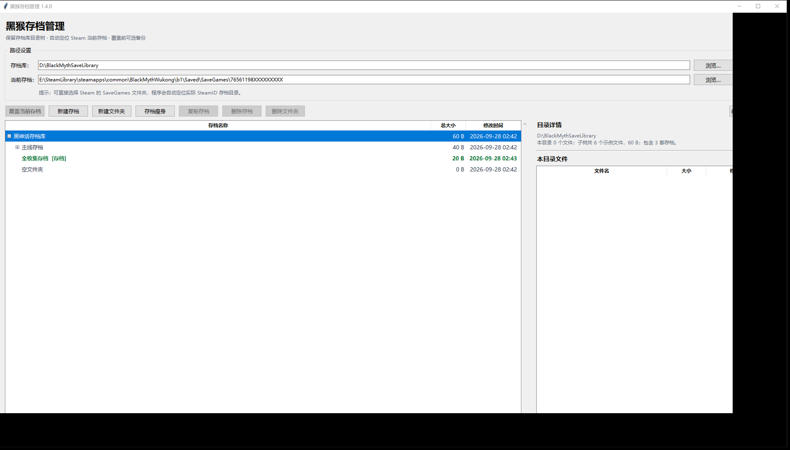
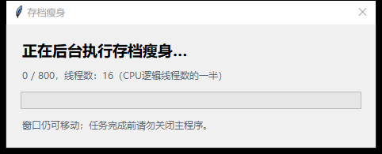

<p align="center">
  
</p>

<h1 align="center">黑猴 / 影之刃零存档管理</h1>

一个面向 Windows 的本地存档管理 GUI，支持《黑神话：悟空》和《影之刃零》。用于浏览、备份、覆盖、整理和瘦身存档，不修改游戏本体文件；影之刃零在游戏运行时还会把覆盖后的存档直接写入游戏内存。



## 支持的游戏

| 游戏 | 自动识别目录 | 存档库识别规则 |
| --- | --- | --- |
| 黑神话：悟空 | `...\BlackMythWukong\b1\Saved\SaveGames\SteamID` | 沿用原有规则，以 `ArchiveSaveFile.*.sav` 识别存档目录 |
| 影之刃零 | `...\PBZ\ProjectPBZ\Saved\SaveGames\Steam\SteamID` | 仅 `PBZSaveGame.sav` 是有效存档文件 |

程序会扫描已登记的 Steam 库和常见 Steam 库路径，并兼容不同 SteamID 子目录。也可以在界面中手动选择或填写存档库、当前存档目录。

## 功能

- “当前游戏”下拉框可切换《黑神话：悟空》和《影之刃零》
- 切换游戏时自动恢复该游戏上次使用的存档库和当前存档目录，并重置目录树与选中状态
- 自动扫描 Steam 库，定位两个游戏各自的 `SaveGames\SteamID` 当前存档目录
- 保留存档库原有目录树，空文件夹也会显示
- 覆盖当前存档，覆盖前可选备份；影之刃零在游戏运行时自动写入游戏内存，无需 UE4SS
- 新建存档、新建空文件夹、复制、删除、重命名
- 支持删除不包含可识别存档的普通文件夹
- 后台存档瘦身、实时进度、删除优先移入 Windows 回收站
- 完整右键菜单、刷新状态保持、Per-Monitor V2 DPI 适配
- 按游戏分别保存存档库路径、当前存档路径和上次选择的游戏

## 文件规则

### 黑神话：悟空

- 存档目录以 `ArchiveSaveFile.*.sav` 识别。
- 覆盖采用完整镜像替换。
- `UserSettingSaveGame.sav` 属于按键和操作设置：当前存档已有该文件时不会覆盖；当前存档没有时，会从来源存档复制。
- 存档瘦身默认每个目录保留 `ArchiveSaveFile.2.sav`。

### 影之刃零

- 只有 `PBZSaveGame.sav` 会被识别为有效存档。
- 存档库中的其他 `.sav`、`steam_autocloud.vdf`、`1RealTime` / `2Hourly` / `3Daily` 等备份文件不会作为存档展示。
- 覆盖时只替换当前存档目录中的 `PBZSaveGame.sav`，不会改动当前目录中的其他文件。
- 新建存档或复制存档时，只复制 `PBZSaveGame.sav`。
- 存档瘦身时，每个目录只保留 `PBZSaveGame.sav`，其他文件优先移入 Windows 回收站；目录层级和空文件夹保留。

### 影之刃零运行时内存写入

检测到 `PBZ.exe` 正在运行时，点击“覆盖当前存档”会在替换 `PBZSaveGame.sav` 后立即执行以下流程：

1. 存档管理器自行向游戏进程注入 `native/pbz_bridge/pbz_bridge.dll`；
2. 桥接 DLL 解密 PBZS 容器（AES-256-GCM）并用 Oodle 解压每个槽位的 JSON；
3. 在游戏线程中逐槽调用 `UPBZSaveLoadSubsystem::ReplaceSaveString`；
4. `__Advanced__` 固定最后写入，避免普通槽位被忽略。

整个过程**不依赖 UE4SS**，也不要求预先安装任何 MOD。建议先回到游戏标题界面再覆盖，覆盖完成后直接点击“继续/读取”即可看到新存档。

桥接不会 Hook `UEngine::Tick` 或 `ProcessEvent`。它临时替换游戏主窗口的窗口过程，再通过自定义窗口消息把每个槽位的写入任务投递到窗口所属线程执行，因此不会和 UE4SS 争抢引擎钩子，也不要求 UE4SS 存在。

已在“加载 UE4SS”和“无 UE4SS”两种环境下分别实机验证：测试主存档的所有槽位均完成 `ReplaceSaveString` 调用，游戏进程保持运行。

当前桥接按 PBZ Steam build `26367565`（`PBZ.exe` timestamp `1793568319`）校验函数布局；游戏更新导致版本不匹配时，管理器会保留磁盘覆盖结果并明确提示内存写入失败，不会盲目调用错误地址。

## 界面截图

### 主界面


### 存档瘦身进度



## 运行

要求：

- Windows 10 / 11
- Python 3.10+（从源码运行时）

安装后运行：

```powershell
python -m pip install .
black-myth-save-manager
```

也可以直接运行源码：

```powershell
python src/black_myth_save_manager.py
```

## 构建单文件 EXE

```powershell
.\build.ps1
```

输出：

```text
dist\BlackMythSaveManager.exe
```

构建脚本会自动编译 PBZ 内存桥接、安装 PyInstaller，并嵌入 DPI 感知清单和 `1.7.0.0` 版本资源。

## 使用说明

1. 启动程序，在“当前游戏”下拉框选择《黑神话：悟空》或《影之刃零》。
2. 选择该游戏的存档库根目录。
3. 程序会自动寻找该游戏的当前存档；也可以点击“浏览…”手动选择，或直接填写路径。
4. 在左侧选择标记为 `[存档]` 的目录。
5. 点击“覆盖当前存档”，选择是否先备份；若《影之刃零》正在运行，程序会在磁盘替换后自动写入游戏内存。
6. 勾选“本次运行不再提醒”后，当前进程内后续覆盖会直接按记住的方式执行，不再弹确认或完成提示；重启程序后恢复提醒。

当前游戏、两个游戏各自的存档库路径和当前存档路径会保存到：

```text
%APPDATA%\BlackMythSaveManager\settings.json
```

设置文件使用按游戏隔离的结构，例如：

```json
{
  "version": 2,
  "game": "phantom_blade_zero",
  "games": {
    "black_myth_wukong": {
      "source_directory": "D:\\存档库\\黑神话",
      "current_save_directory": "E:\\SteamLibrary\\steamapps\\common\\BlackMythWukong\\b1\\Saved\\SaveGames\\SteamID"
    },
    "phantom_blade_zero": {
      "source_directory": "D:\\存档库\\影之刃零",
      "current_save_directory": "E:\\SteamLibrary\\steamapps\\common\\PBZ\\ProjectPBZ\\Saved\\SaveGames\\Steam\\SteamID"
    }
  }
}
```

旧版本的顶层 `source_directory` / `current_save_directory` 会自动迁移到黑神话配置。

备份保存在：

```text
%LOCALAPPDATA%\BlackMythSaveManager\Backups
```

## 存档瘦身

瘦身会递归处理所选目录，并保留目录层级与空文件夹：

- 黑神话：悟空：每个目录只保留 `ArchiveSaveFile.2.sav`
- 影之刃零：每个目录只保留 `PBZSaveGame.sav`
- 其他文件优先移入 Windows 回收站
- 回收站不可用时，可确认后使用后台线程永久删除
- 默认线程数为 `CPU逻辑线程数 ÷ 2`
- 支持实时进度显示

## 项目结构

```text
.
├── assets/screenshots/       # README 截图
├── native/pbz_bridge/        # 不依赖 UE4SS 的 PBZ 进程内桥接
│   ├── pbz_bridge.cpp
│   ├── oo2core_9_win64.dll
│   └── build.ps1
├── packaging/
│   ├── app.manifest          # Windows DPI / 长路径清单
│   └── version_info.txt      # EXE 版本资源
├── src/
│   └── black_myth_save_manager.py
├── tests/self_check.py       # 双游戏规则自检
├── build.ps1
├── pyproject.toml
└── README.md
```

## 自检

```powershell
python -m py_compile src/black_myth_save_manager.py tests/self_check.py
python tests/self_check.py
```

自检覆盖：

- 黑神话覆盖规则及 `UserSettingSaveGame.sav` 保护
- 黑神话当前存档自动识别
- 影之刃零仅识别、复制和覆盖 `PBZSaveGame.sav`
- 影之刃零存档树过滤、瘦身目标和不同 SteamID 识别
- 双游戏设置迁移与隔离

## 安全说明

- 覆盖、删除和瘦身操作前请确认目标目录。
- 删除和瘦身默认使用 Windows 回收站，不会直接永久删除。
- 黑神话覆盖采用完整镜像替换；影之刃零覆盖只替换 `PBZSaveGame.sav`。
- 《影之刃零》游戏运行时覆盖后会自动写入游戏内存；仍建议回到标题界面再继续/读取。
- 《黑神话：悟空》游戏运行时覆盖后，请回到标题界面重新读取存档。
- 请先备份重要存档，再执行批量操作。

## 更新记录

### 1.7.0（2026-11-12）

- 《影之刃零》覆盖存档后，游戏运行时可直接写入游戏内存，无需重启进程。
- 通过临时窗口过程与自定义窗口消息调度游戏线程，不 Hook `UEngine::Tick` / `ProcessEvent`。
- 不依赖 UE4SS，并已验证安装/未安装 UE4SS 两种环境。
- 原生桥接自行完成 PBZS 解密、AES-256-GCM、Oodle 解压和 `ReplaceSaveString` 注入。

## 免责声明

本项目是非官方工具，与游戏开发商、发行商及 Steam 无关。使用本项目造成的存档丢失、损坏或其他风险由使用者自行承担。

## License

[MIT](LICENSE)
