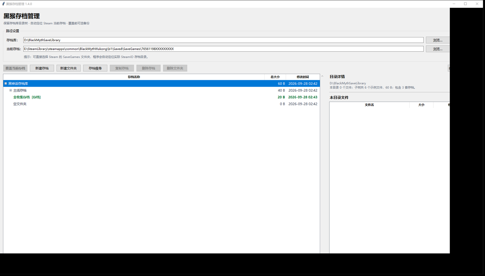
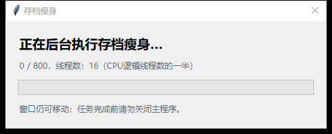

<p align="center">
  
</p>

<h1 align="center">黑猴 / 影之刃零存档与 Mod 管理</h1>

一个面向 Windows 的本地存档与 Mod 管理 GUI，支持《黑神话：悟空》和《影之刃零》。既可以浏览、备份、覆盖、整理和瘦身存档，也可以从 Mod 库读取 Mod、自动识别安装类型与位置、安装并随时安全卸载。



## 支持的游戏

| 游戏 | 自动识别目录 | 存档库识别规则 | 默认 Mod 库 |
| --- | --- | --- | --- |
| 黑神话：悟空 | `...\BlackMythWukong\b1\Saved\SaveGames\SteamID` | 沿用原有规则，以 `ArchiveSaveFile.*.sav` 识别存档目录 | `G:\games\mod\黑猴` |
| 影之刃零 | `...\PBZ\ProjectPBZ\Saved\SaveGames\Steam\SteamID` | 仅 `PBZSaveGame.sav` 是有效存档文件 | `G:\games\mod\影之刃` |

程序会扫描已登记的 Steam 库和常见 Steam 库路径，并兼容不同 SteamID 子目录。也可以在界面中手动选择或填写存档库、当前存档目录。

## 功能

- 主窗口右上角的“当前游戏”下拉框可切换《黑神话：悟空》和《影之刃零》，三个功能标签页会同步切换
- 切换游戏时自动恢复该游戏上次使用的存档库、当前存档目录和 Mod 路径，并刷新存档树、Mod 列表和修改器项目
- Mod 与修改器表格支持拖动表头调整列宽，列宽会自动记忆，重启程序后仍然保留
- Mod 管理页支持一键通过 Steam 启动当前游戏
- 自动扫描 Steam 库，定位两个游戏各自的 `SaveGames\SteamID` 当前存档目录
- 保留存档库原有目录树，空文件夹也会显示
- 覆盖当前存档，覆盖前可选备份；影之刃零在游戏运行时自动写入游戏内存，无需 UE4SS
- 新建存档、新建空文件夹、复制、删除、重命名
- 支持删除不包含可识别存档的普通文件夹
- 后台存档瘦身、实时进度、删除优先移入 Windows 回收站
- 完整右键菜单、刷新状态保持、Per-Monitor V2 DPI 适配
- 按游戏分别保存存档库路径、当前存档路径和上次选择的游戏
- Mod 库按游戏读取 ZIP、Pak 文件和已解压 Mod 文件夹
- 自动识别 C# Mod、CSharpLoader、UE4SS Mod、UE4SS 本体、Pak/Logic Mod 和通用游戏文件
- 安装前备份会被覆盖的原文件，卸载时仅删除安装清单记录的文件并恢复原文件
- 卸载遇到 DLL/Pak 文件被游戏或工具占用时，保留失败清单和备份，完全退出后可重试

## 文件规则

### 黑神话：悟空

- 存档目录以 `ArchiveSaveFile.*.sav` 识别。
- 覆盖采用完整镜像替换。
- `UserSettingSaveGame.sav` 属于按键和操作设置：当前存档已有该文件时不会覆盖；当前存档没有时，会从来源存档复制。
- 存档瘦身默认每个目录保留 `ArchiveSaveFile.2.sav`。

### 影之刃零

- 只有 `PBZSaveGame.sav` 会被识别为有效存档。
- 存档库中的其他 `.sav`、`steam_autocloud.vdf`、`1RealTime` / `2Hourly` / `3Daily` 等备份文件不会作为存档展示。
- 覆盖时只替换当前存档目录中的 `PBZSaveGame.sav`，不会改动当前目录中的其他文件。
- 新建存档或复制存档时，只复制 `PBZSaveGame.sav`。
- 存档瘦身时，每个目录只保留 `PBZSaveGame.sav`，其他文件优先移入 Windows 回收站；目录层级和空文件夹保留。

### 影之刃零运行时内存写入

检测到 `PBZ.exe` 正在运行时，点击“覆盖当前存档”会在替换 `PBZSaveGame.sav` 后立即执行以下流程：

1. 存档管理器自行向游戏进程注入 `native/pbz_bridge/pbz_bridge.dll`；
2. 桥接 DLL 解密 PBZS 容器（AES-256-GCM）并用 Oodle 解压每个槽位的 JSON；
3. 在游戏线程中逐槽调用 `UPBZSaveLoadSubsystem::ReplaceSaveString`；
4. `__Advanced__` 固定最后写入，避免普通槽位被忽略。

整个过程**不依赖 UE4SS**，也不要求预先安装任何 MOD。建议先回到游戏标题界面再覆盖，覆盖完成后直接点击“继续/读取”即可看到新存档。

桥接不会 Hook `UEngine::Tick` 或 `ProcessEvent`。它临时替换游戏主窗口的窗口过程，再通过自定义窗口消息把每个槽位的写入任务投递到窗口所属线程执行，因此不会和 UE4SS 争抢引擎钩子，也不要求 UE4SS 存在。

已在“加载 UE4SS”和“无 UE4SS”两种环境下分别实机验证：测试主存档的所有槽位均完成 `ReplaceSaveString` 调用，游戏进程保持运行。

当前桥接按 PBZ Steam build `26367565`（`PBZ.exe` timestamp `1793568319`）校验函数布局；游戏更新导致版本不匹配时，管理器会保留磁盘覆盖结果并明确提示内存写入失败，不会盲目调用错误地址。

## Mod 管理标签页

主界面分为“存档管理”、“Mod 管理”和“修改器”三个标签页，点击顶部标签即可切换。Mod 库路径按游戏保存，默认分别为：

```text
G:\games\mod\黑猴
G:\games\mod\影之刃
```

游戏安装目录会通过 Steam 库、存档路径和常见 Steam 路径自动识别，也可以手动选择。列表会显示每个 Mod 的识别类型、目标位置、大小和安装状态。

支持的 Mod 结构：

| 识别类型 | 黑神话：悟空目标位置 | 影之刃零目标位置 |
| --- | --- | --- |
| C# Mod | `b1\Binaries\Win64\CSharpLoader\Mods\<Mod>` | 不适用 |
| C# 加载器 / 整合包 | `b1\Binaries\Win64` | 不适用 |
| UE4SS Mod | `b1\Binaries\Win64\ue4ss\Mods\<Mod>` | `platform\steam\ue4ss\Mods\<Mod>` |
| UE4SS 本体 | `b1\Binaries\Win64` | `platform\steam` |
| Pak / Logic Mod | `b1\Content\Paks`（裸 Pak 放入 `~mods`） | `ProjectPBZ\Content\Paks`（裸 Pak 放入 `~mods`） |
| 通用游戏文件 | 按包内 `b1` 结构安装 | 按 `ProjectPBZ` / `platform\steam` 结构安装 |

安装时会将目标位置已有的同名文件备份到 `%LOCALAPPDATA%\BlackMythSaveManager\ModBackups`，并写入安装清单 `%APPDATA%\BlackMythSaveManager\mod_installations.json`。卸载只处理该清单中的文件，不会删除 `ue4ss\Mods`、`CSharpLoader\Mods` 等共享目录中的其他内容。

如果卸载时 DLL、Pak 或其他文件被游戏、Mod 工具或杀毒软件占用，管理器会：

1. 继续处理其余可删除文件；
2. 保留删除失败的文件和待恢复备份；
3. 将状态标记为“卸载未完成”；
4. 完全退出游戏或关闭占用程序后，再次点击“卸载所选 Mod”即可继续。

目前直接支持 ZIP、Pak 文件和已解压文件夹；`.7z`、`.rar` 请先解压或转为 ZIP。

## 修改器标签页

程序启动时不会主动连接游戏；首次切换到“修改器”页后，才按当前游戏自动连接正在运行的进程。未启动游戏时保持等待；检测到游戏窗口后会加载对应功能，不需要手动选择进程。快捷键按游戏分别保存，切换游戏后会注册该游戏的快捷键。点击快捷键按钮后直接按键即可重新绑定，按 `Esc` 会清空为“无”。开关使用滑动开关控件，功能开启和关闭使用不同的提示音；数值列会显示当前读到的生命、韧性或攻击力，游戏速度固定放在最后一行。

黑神话：悟空包含：

- 无限生命
- 最高韧性
- 超级伤害 / 一击必杀
- 设置游戏速度
- 编辑攻击

影之刃零包含：

- 无限生命
- 超级伤害 / 一击必杀
- 伤害倍率
- 解锁六十六天难度
- 设置游戏速度

修改器使用特征码定位游戏代码，版本不匹配或特征码缺失时会保持等待并显示错误，不会盲目写入固定地址。游戏更新后如提示“未找到特征码”，需要重新提取对应版本特征码。

影之刃零的功能按原修改器的脚本对齐：

- 无限生命使用 `aobattributes`，将玩家 `Health` 更新为 `Health_Max` 的两倍。
- 超级伤害/伤害倍率使用 `aobdamage`，只处理 `FName=Health` 的非玩家目标。
- 游戏速度使用原修改器同款的 `TrSpeedHack_x64.dll`，以千分比设置全局时间速度，例如 `2.5x` 写入 `2500`。
- 解锁六十六天难度通过 UE 反射查找 `PBZGameSystem.bCanSelectNightMare` 并写入，不依赖固定对象地址。

黑神话的“设置游戏速度”也使用同一个 `TrSpeedHack_x64.dll`；原黑猴修改器内嵌组件的 SHA-256 与当前程序使用的版本一致。

## 界面截图

### 主界面


### 存档瘦身进度



## 运行

要求：

- Windows 10 / 11
- Python 3.10+（从源码运行时）

安装后运行：

```powershell
python -m pip install .
black-myth-save-manager
```

也可以直接运行源码：

```powershell
python src/black_myth_save_manager.py
```

## 构建单文件 EXE

```powershell
.\build.ps1
```

输出：

```text
dist\BlackMythSaveManager.exe
```

构建脚本会自动编译 PBZ 内存桥接、安装 PyInstaller、收集 `keystone-engine`，并嵌入 DPI 感知清单和 `1.9.3.0` 版本资源。

## 使用说明

1. 启动程序，在“当前游戏”下拉框选择《黑神话：悟空》或《影之刃零》。
2. 选择该游戏的存档库根目录。
3. 程序会自动寻找该游戏的当前存档；也可以点击“浏览…”手动选择，或直接填写路径。
4. 在左侧选择标记为 `[存档]` 的目录。
5. 点击“覆盖当前存档”，选择是否先备份；若《影之刃零》正在运行，程序会在磁盘替换后自动写入游戏内存。
6. 勾选“本次运行不再提醒”后，当前进程内后续覆盖会直接按记住的方式执行，不再弹确认或完成提示；重启程序后恢复提醒。

Mod 管理：

1. 点击主界面顶部的“Mod 管理”标签页。
2. 选择游戏；程序会恢复该游戏上次使用的 Mod 库和游戏安装目录。
3. 默认 Mod 库为 `G:\games\mod\黑猴` / `G:\games\mod\影之刃`，也可以手动选择。
4. 在列表中选择 Mod，确认“识别类型”和“安装位置”后点击“安装所选 Mod”。
5. 需要卸载时选择状态为“已安装”或“卸载未完成”的 Mod，点击“卸载所选 Mod”。
6. 如果提示文件被占用，请完全退出游戏并关闭相关 Mod 工具，再次点击卸载；不要手动删除安装清单。

当前游戏、两个游戏各自的存档路径、Mod 库路径和游戏安装目录会保存到：

```text
%APPDATA%\BlackMythSaveManager\settings.json
```

设置文件使用按游戏隔离的结构，例如：

```json
{
  "version": 2,
  "game": "phantom_blade_zero",
  "games": {
    "black_myth_wukong": {
      "source_directory": "D:\\存档库\\黑神话",
      "current_save_directory": "E:\\SteamLibrary\\steamapps\\common\\BlackMythWukong\\b1\\Saved\\SaveGames\\SteamID"
    },
    "phantom_blade_zero": {
      "source_directory": "D:\\存档库\\影之刃零",
      "current_save_directory": "E:\\SteamLibrary\\steamapps\\common\\PBZ\\ProjectPBZ\\Saved\\SaveGames\\Steam\\SteamID"
    }
  },
  "mods": {
    "black_myth_wukong": {
      "library_directory": "G:\\games\\mod\\黑猴",
      "game_directory": "E:\\SteamLibrary\\steamapps\\common\\BlackMythWukong"
    },
    "phantom_blade_zero": {
      "library_directory": "G:\\games\\mod\\影之刃",
      "game_directory": "E:\\SteamLibrary\\steamapps\\common\\PBZ"
    }
  }
}
```

旧版本的顶层 `source_directory` / `current_save_directory` 会自动迁移到黑神话配置。

备份保存在：

```text
%LOCALAPPDATA%\BlackMythSaveManager\Backups
```

Mod 安装前的原文件备份保存在：

```text
%LOCALAPPDATA%\BlackMythSaveManager\ModBackups
```

Mod 安装清单保存在：

```text
%APPDATA%\BlackMythSaveManager\mod_installations.json
```

## 存档瘦身

瘦身会递归处理所选目录，并保留目录层级与空文件夹：

- 黑神话：悟空：每个目录只保留 `ArchiveSaveFile.2.sav`
- 影之刃零：每个目录只保留 `PBZSaveGame.sav`
- 其他文件优先移入 Windows 回收站
- 回收站不可用时，可确认后使用后台线程永久删除
- 默认线程数为 `CPU逻辑线程数 ÷ 2`
- 支持实时进度显示

## 项目结构

```text
.
├── assets/screenshots/       # README 截图
├── native/pbz_bridge/        # 不依赖 UE4SS 的 PBZ 进程内桥接
│   ├── pbz_bridge.cpp
│   ├── oo2core_9_win64.dll
│   └── build.ps1
├── native/speedhack/         # 影之刃全局游戏速度组件
│   └── TrSpeedHack_x64.dll
├── packaging/
│   ├── app.manifest          # Windows DPI / 长路径清单
│   └── version_info.txt      # EXE 版本资源
├── src/
│   ├── black_myth_save_manager.py  # 存档管理 + Mod 管理 + 修改器界面
│   └── trainer_core.py             # 特征码定位、Hook、快捷键与自动连接
├── tests/self_check.py       # 双游戏规则、Mod、修改器配置与特征码自检
├── build.ps1
├── pyproject.toml
└── README.md
```

## 自检

```powershell
python -m py_compile src/black_myth_save_manager.py src/trainer_core.py tests/self_check.py
python tests/self_check.py
```

自检覆盖：

- 黑神话覆盖规则及 `UserSettingSaveGame.sav` 保护
- 黑神话当前存档自动识别
- 影之刃零仅识别、复制和覆盖 `PBZSaveGame.sav`
- 影之刃零存档树过滤、瘦身目标和不同 SteamID 识别
- 双游戏设置迁移与隔离
- 黑猴 C# Mod、Pak Mod 与影之刃 UE4SS 本体、UE4SS Mod 的类型识别
- Mod 安装清单、覆盖前备份、文件占用导致卸载失败后的重试
- 修改器默认快捷键、按游戏记忆和快捷键解析
- 已安装游戏的修改器特征码与代码洞穴检查

## 安全说明

- 覆盖、删除和瘦身操作前请确认目标目录。
- 删除和瘦身默认使用 Windows 回收站，不会直接永久删除。
- 黑神话覆盖采用完整镜像替换；影之刃零覆盖只替换 `PBZSaveGame.sav`。
- 《影之刃零》游戏运行时覆盖后会自动写入游戏内存；仍建议回到标题界面再继续/读取。
- 《黑神话：悟空》游戏运行时覆盖后，请回到标题界面重新读取存档。
- 请先备份重要存档，再执行批量操作。
- 安装或卸载 Mod 前建议完全退出游戏；文件被占用时请勿强删安装清单或备份目录。
- 卸载 Mod 只删除本程序安装清单记录的文件；仍请避免多个 Mod 覆盖同一目标文件。

## 更新记录

### 1.9.3（2026-11-23）

- 修正黑神话无限生命、最高韧性与超级伤害挂错属性函数的问题；三个功能恢复为原修改器同款逻辑。
- 数值列显示当前读到的生命、韧性、攻击力，超级伤害行显示玩家攻击力。
- 游戏速度移动到功能列表最后一项。
- 编辑攻击改为开关：开启时记录原攻击力并应用新值，关闭时恢复原攻击力。

### 1.9.0（2026-11-22）

- 新增“修改器”标签页，支持《黑神话：悟空》和《影之刃零》。
- 游戏启动后自动连接对应进程，版本或特征码不匹配时停止注入并提示。
- 快捷键按游戏记忆，支持全局快捷键注册。
- 新增黑猴无限生命、最高韧性、超级伤害、游戏速度和编辑攻击。
- 新增影之刃零无限生命、超级伤害、伤害倍率、解锁六十六天难度和游戏速度。

### 1.8.1（2026-11-22）

- 主界面改为“存档管理”和“Mod 管理”两个标签页，不再使用独立 Mod 窗口。
- 存档页保留原有路径设置、目录树、覆盖、瘦身和右键菜单功能。
- Mod 页直接读取当前游戏 Mod 库，并保留安装、卸载、占用失败重试和详情展示。

### 1.8.0（2026-11-22）

- 主界面改为“存档管理”和“Mod 管理”两个标签页。
- 新增双游戏 Mod 管理器，默认读取 `G:\games\mod\黑猴` 和 `G:\games\mod\影之刃`。
- 自动识别 C# Mod、CSharpLoader、UE4SS Mod、UE4SS 本体、Pak/Logic Mod 与通用游戏文件。
- 自动定位 Steam 游戏安装目录，并显示每个 Mod 的具体安装位置。
- 安装前备份被覆盖的原文件，安装清单记录每个写入文件。
- 支持随时卸载；文件被占用时保留未完成记录和备份，退出游戏后可继续重试。

### 1.7.0（2026-11-12）

- 《影之刃零》覆盖存档后，游戏运行时可直接写入游戏内存，无需重启进程。
- 通过临时窗口过程与自定义窗口消息调度游戏线程，不 Hook `UEngine::Tick` / `ProcessEvent`。
- 不依赖 UE4SS，并已验证安装/未安装 UE4SS 两种环境。
- 原生桥接自行完成 PBZS 解密、AES-256-GCM、Oodle 解压和 `ReplaceSaveString` 注入。

## 免责声明

本项目是非官方工具，与游戏开发商、发行商及 Steam 无关。使用本项目造成的存档丢失、损坏或其他风险由使用者自行承担。

## License

[MIT](LICENSE)
